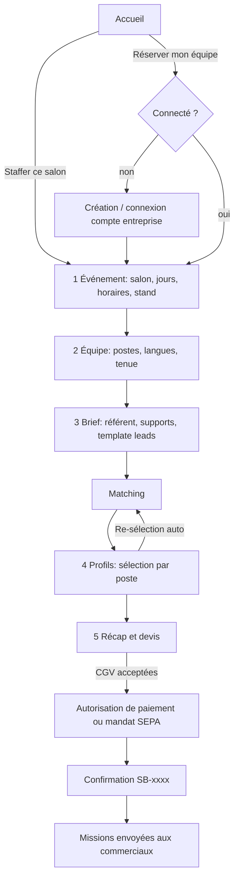
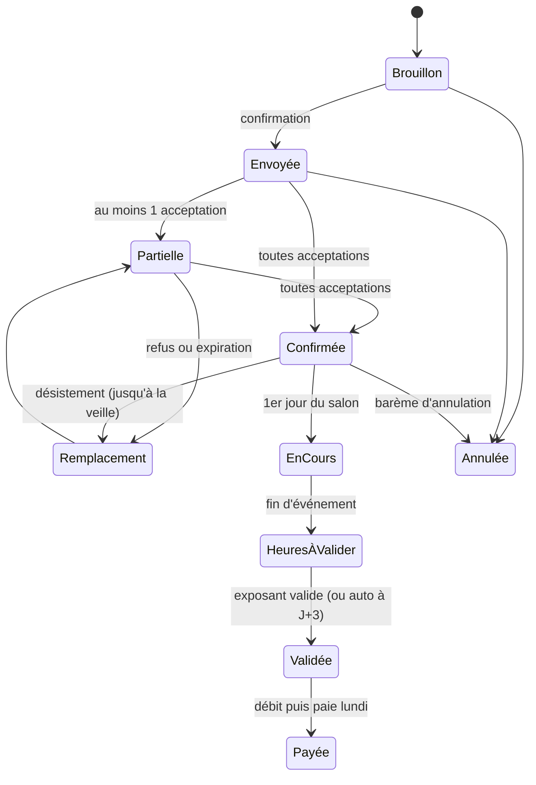
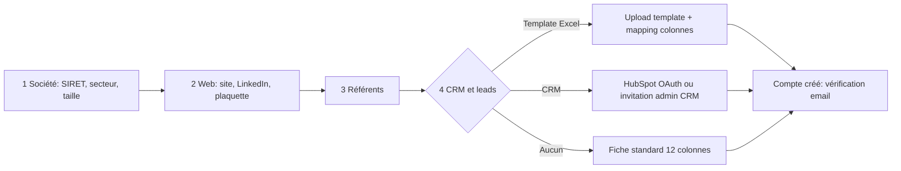
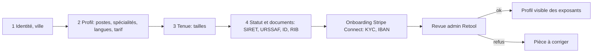
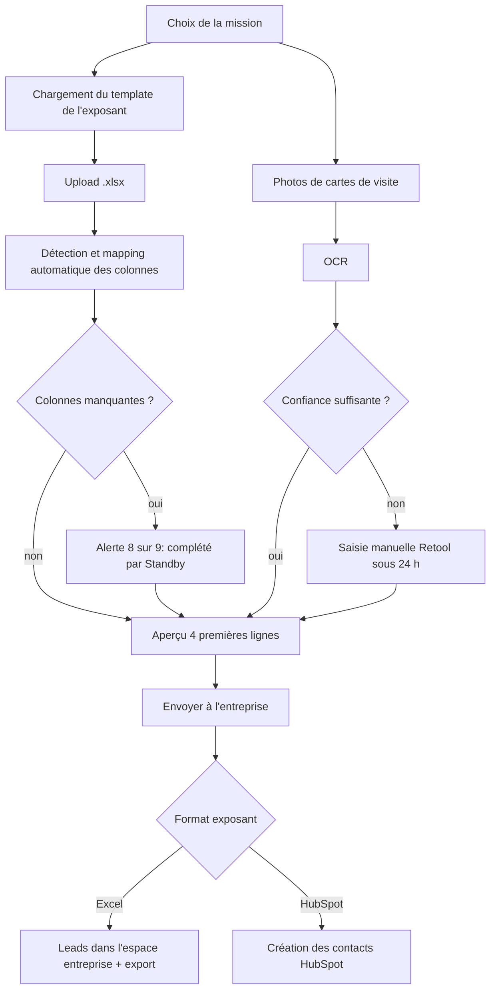
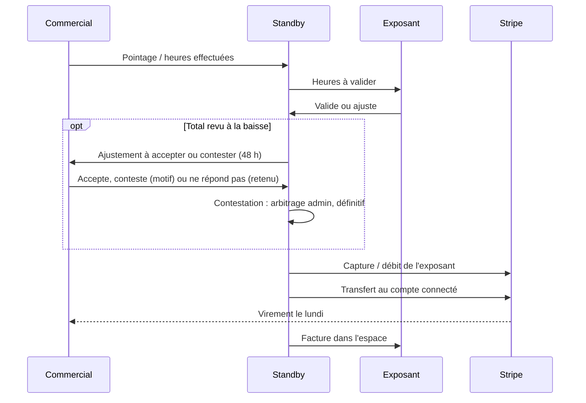

# Standby Salons : Flux

## 1. Parcours de réservation (exposant)

Brouillon enregistré à chaque étape (reprise possible). Estimation HT recalculée côté serveur à chaque changement.

## 2. Cycle de vie d'une réservation

Statut d'une assignation (commercial) : `proposée → acceptée | refusée | expirée → effectuée → heures_validées → payée`, ou `acceptée → désistée` avant l'événement (remplaçant proposé, au même tarif ou moins en priorité ; motif transmis à l'équipe Standby seulement).

## 3. Chronologie post-réservation (design « Confirmation »)

| Quand | Action | Acteur |
|---|---|---|
| Aujourd'hui | Mission proposée aux commerciaux avec brief et plaquette | Système |
| J-7 | Demande des badges exposants à l'organisateur | Standby (tâche back-office) |
| J-2 | Briefing visio avec le référent | Exposant + équipe |
| Chaque soir | Dépôt des leads au format du template | Commercial |
| Lundi suivant | Validation des heures, paie, facture | Exposant, système |

## 4. Inscription exposant

SIRET contrôlé via API SIRENE à l'étape 1.

## 5. Inscription commercial·e

Le profil n'apparaît dans le matching qu'après validation des documents.

## 6. Dépôt de leads (commercial → exposant)

## 7. Heures, paiement, paie

Heures par jour : `declare → valide`, ou `declare → ajuste → valide | conteste → valide (arbitrage)`. La facture n'est émise qu'une fois toutes les heures validées.

Avoir : émis par l'admin depuis la fiche réservation (motif, montant TTC ≤ reste à créditer, même taux de TVA que la facture). Facture réglée : remboursement Stripe (`refund.updated` suit l'aboutissement, relance ou « remboursé par virement » en cas d'échec). Non réglée : déduit du prélèvement, réservation soldée à zéro. La paie des commerciaux n'est jamais modifiée par un avoir.

## 7 bis. Compte

- Mot de passe : l'actuel est exigé ; tous les autres appareils sont déconnectés (version de session incrémentée, aussi après une réinitialisation), alerte par e-mail.
- E-mail : mot de passe exigé, lien de confirmation (24 h) envoyé à la nouvelle adresse, alerte sur l'ancienne ; l'ancienne reste l'identifiant jusqu'au clic.

## 8. Plan de navigation (écrans du design → routes)

| Écran | Route Next.js |
|---|---|
| Accueil | `/` |
| Comptes (choix) | `/comptes` |
| Inscription entreprise | `/inscription/entreprise` |
| Inscription commercial | `/inscription/commercial` |
| Réserver 1 à 5 | `/reserver/evenement`, `/equipe`, `/brief`, `/profils`, `/recap` (`?r=<id>`) |
| Confirmation | `/reserver/confirmation/[ref]` |
| Espace entreprise | `/entreprise` |
| Espace commercial | `/commercial`, `/commercial/leads/[missionId]` |
| Contact, FAQ, Plan du site | `/contact`, `/aide`, `/plan-du-site` |
| Légal | `/mentions-legales`, `/cgu`, `/cgv`, `/confidentialite`, `/cookies`, `/accessibilite` |
