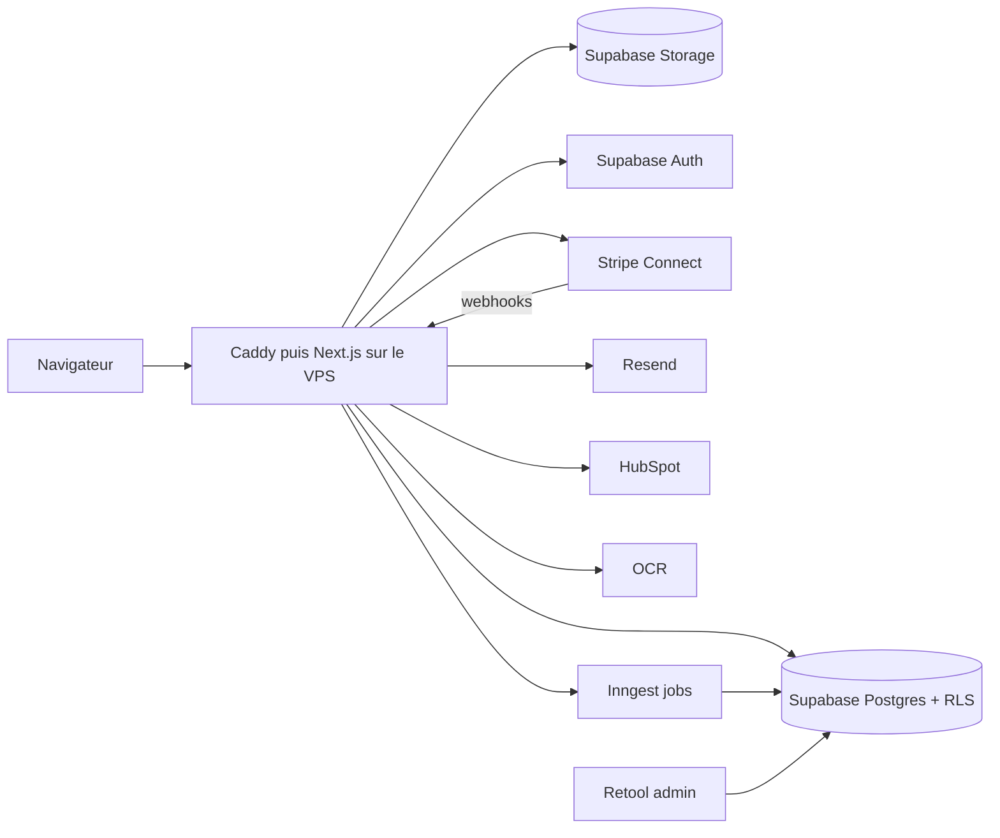

# Standby Salons : Architecture technique

## 1. Choix validés

| Domaine | Choix |
|---|---|
| Front et back | Next.js (App Router) + TypeScript, Server Actions et route handlers |
| UI | CSS « Clay » repris du design (`app/globals.css`, sans Tailwind) + composants React ; formulaires en Server Actions, contrôles natifs stylés (`:has()`) |
| Base de données | PostgreSQL (Supabase, région UE) via Drizzle ORM en connexion directe ; migrations `db/migrations` appliquées au démarrage. Autorisations dans le code serveur (chaque requête filtrée par entreprise / commercial) ; RLS laissée active sans règle pour fermer l'API publique Supabase. En local : PGlite |
| Auth | Supabase Auth comme fournisseur d'identité (création, vérification du mot de passe, changement), session applicative en cookie signé HMAC (30 jours) ; rôles `exposant`, `commercial`, `admin`. En local : scrypt |
| Stockage | Supabase Storage (buckets `private` et `public`), fichiers servis par `/api/fichiers` avec contrôle d'accès. En local : `.data/uploads` |
| Paiement | Stripe Connect : mandat SEPA ou carte enregistré à la confirmation (Checkout en mode setup), débit après validation des heures, transferts vers les comptes Express, virements hebdomadaires le lundi. Simulé sans clé |
| Emails | Resend via son API HTTP ; notifications aussi visibles dans `/notifications` |
| Jobs asynchrones | Conteneur cron du VPS qui appelle `/api/cron` toutes les 15 min (statuts, expiration 48 h + remplaçant, validation J+3, virements) |
| Excel | `exceljs` (lecture, rapprochement des colonnes par synonymes, export au format de l'entreprise) |
| OCR cartes | Claude (vision + sortie structurée, `@anthropic-ai/sdk`) ; repli sur la saisie manuelle dans `/admin/cartes` |
| CRM | HubSpot OAuth (portées `crm.objects.contacts.write` et `.read`), jetons chiffrés AES-256-GCM, invitation de l'admin CRM par lien signé |
| Back-office | Espace `/admin` dans Next.js (rôle `admin`, table `audit_log`) |
| Hébergement | **VPS** (Docker Compose : Next.js standalone + Caddy pour HTTPS) + Supabase cloud UE (Paris ou Francfort) ; voir `deploy/` |
| Observabilité | Sentry, PostHog (hébergement UE), logs Docker, alertes Stripe webhooks |
| Qualité | Vitest (dont un test du parcours complet sur PGlite), ESLint, TypeScript strict, GitHub Actions ; Playwright et axe-core à ajouter |

> Le schéma détaillé est dans `db/schema.ts` (24 tables), la logique métier dans `lib/services/*` (testable sans Next.js), les écrans dans `app/`.

Remarque Retool + Airtable : Retool suffit et lit directement Postgres. Airtable créerait un second référentiel, à éviter.

## 2. Vue d'ensemble



## 3. Modèle de données (principales tables)

```
users            (id, email, role, created_at)                       -- Supabase auth.users
companies        (id, owner_id, name, siret, sector, size, website, linkedin_url, brochure_path, lead_mode)
company_referents(id, company_id, name, title, phone)
lead_templates   (id, company_id, name, columns jsonb, source: 'excel'|'standard')
crm_connections  (id, company_id, provider, admin_email, status, tokens_encrypted)
freelancers      (id, user_id, first_name, last_name, city, bio, siret, status, stripe_account_id, rating_avg, missions_count)
freelancer_roles (freelancer_id, role, hourly_rate, is_primary)
freelancer_specialties / freelancer_languages (freelancer_id, value)
freelancer_sizes (freelancer_id, top, pants, shoe)
freelancer_docs  (id, freelancer_id, type: id|urssaf|rib|siret, path, status, reviewed_by, reviewed_at)
events           (id, name, kind: 'salon'|'foire', city, starts_on, ends_on, setup_day, sector, site_url, verified_on, logo_path, logo_authorized bool)
pricing_settings (id, key, value, effective_from, created_by)   -- service_fee_pct, freelancer_commission_pct, outfit_surcharge, vat_pct, floors/ceilings par poste ; le devis lit la ligne en vigueur
bookings         (id, ref, company_id, event_id, stand, start_time, end_time, billable_hours_per_day, outfit_mode, referent_id,
                  brief, highlights, lead_template_id, lead_frequency, status, quote jsonb, cgv_accepted_at)
booking_days     (booking_id, day, is_setup)
booking_positions(id, booking_id, role, qty, languages text[])
assignments      (id, booking_id, position_id, freelancer_id, hourly_rate, status, accepted_at)
timesheets       (id, assignment_id, day, hours_declared, hours_validated, disputed)
payments         (id, booking_id, stripe_payment_intent, amount_ht, vat, amount_ttc, service_fee, status)
payouts          (id, assignment_id, stripe_transfer_id, amount, scheduled_for, status)
invoices         (id, booking_id, number, pdf_path, issued_at)
lead_batches     (id, assignment_id, template_id, source: 'xlsx'|'cards', mapping jsonb, rows_count, status, sent_at)
leads            (id, batch_id, data jsonb, completed_by_standby bool)
business_cards   (id, batch_id, image_path, ocr_json, confidence, transcribed_by)
favorites        (company_id, freelancer_id)
reviews          (id, booking_id, freelancer_id, company_id, rating, comment)
notifications    (id, user_id, type, payload, read_at)
audit_log        (id, actor, action, entity, entity_id, at, diff)
```

Règles clés :
- Montants stockés en centimes (entiers). Le devis est **recalculé côté serveur** (jamais fait confiance au client) et figé à la confirmation.
- RLS : un exposant ne voit que ses `bookings`, `leads`, `timesheets` ; un commercial que ses `assignments`. Pièces d'identité lisibles uniquement par admin (service role).
- Les leads contiennent des données personnelles de tiers : chiffrement au repos Supabase, durée de conservation configurable, export et suppression.

## 4. Calcul du devis (vérifié contre le design)

```
sous_total      = Σ (tarif_horaire × heures_facturées_par_jour × nb_jours × qty)
frais_service   = round(0,12 × sous_total)
total_ht        = sous_total + frais_service
tva             = round(0,20 × total_ht)
total_ttc       = total_ht + tva
```
Exemple du design : (31 + 30) × 32 h = 1 952 €, 20 × 32 h = 640 €, sous-total 2 592 €, frais 311 €, HT 2 903 €, TVA 581 €, TTC 3 484 €. Option « Tenue Standby » : + 3 €/h par personne.

## 5. Matching (règles pondérées)

Filtre dur : disponibilité sur tous les jours, document validé, poste demandé, langues requises.
Score 0–100 : langues (25), spécialité secteur de l'événement (25), note moyenne (20), nombre de salons (10), ville proche (10), favori de l'exposant (5), taux d'acceptation passé (5). Poids dans une table de configuration ; résultat explicable (« 94 % compatible »).

## 6. Paiement (point d'attention)

Le design débite l'exposant après validation des heures. Une autorisation carte expire en environ 7 jours. Options, dans l'ordre de préférence :
1. **Mandat SEPA** signé à la réservation, prélèvement après validation ;
2. Acompte (par ex. 30 %) à la réservation, solde après validation ;
3. Carte enregistrée avec off-session payment (risque d'échec, relance).
Stripe Connect : charges de plateforme, transferts vers comptes Express des commerciaux, payout planifié le lundi. Webhooks idempotents (`stripe_events`), réconciliation quotidienne.

## 7. Sécurité et conformité
- RGPD : registre des traitements, DPA (Supabase, hébergeur du VPS, Stripe, Resend), consentement cookies (CMP conforme CNIL), droit d'accès et d'effacement.
- Secrets dans un `.env` sur le VPS (droits 600, hors dépôt) et secrets GitHub pour la CI, aucune clé côté client ; tokens CRM chiffrés.
- VPS : accès SSH par clé uniquement, pare-feu (80/443/SSH), mises à jour de sécurité automatiques, fail2ban, sauvegardes hors site, utilisateur de déploiement sans root.
- Scan antivirus et validation MIME/taille des uploads (20 Mo), limitation de débit sur auth et upload.
- Journal d'audit sur toute action admin (Retool).
- RGAA : navigation clavier, contrastes ≥ 4,5, `aria-label` des icônes ; tests axe en CI.

## 8. Design system « Clay » (extrait du design)

- Palette : fond `#EDEBE6`, texte `#1B2150`, secondaire `#575B7E`, primaire `#4D58EE`, accent `#FFCD4A`, succès `#68D1A4`, texte lien `#3B45D6`, avatars `#82C9FF` `#B39BFF` `#FF8CB6`.
- Typo : Futura / Jost 700 (titres), Onest 400–800 (texte).
- Surfaces : `.clay` (relief, ombres internes + portée), `.clay.s` (petit), `.sunk` (creusé : champs, pistes).
- Composants : Nav, Stepper 5 étapes, Button (primaire, ghost, sm, xs), Card, Field/Input, Chip/Colc, Segmented, Avatar, Counter −/+, KPI, Table, Badge de statut, Footer.
- Le design est en 1360 px : prévoir les points de rupture tablette/mobile (les artboards « fill » le supposent). Prévoir un mode `prefers-reduced-motion` et vérifier les contrastes des ombres.

## 9. Environnements
`local` (Supabase CLI), `staging` et `production` (deux stacks Docker Compose sur le VPS, domaines distincts, deux projets Supabase). Pas de preview par PR au départ ; CI = lint, typecheck, tests, build. Seed de données (salons, 50+ profils fictifs) pour les démos.

## 10. Structure du repo (proposée)

```
/app                routes (public), (auth), (exposant), (commercial)
/components/clay    design system
/lib                db, stripe, hubspot, ocr, pricing, matching
/db                 schema Drizzle, migrations, seed
/emails             templates React Email
/jobs               fonctions Inngest
/tests              unit, e2e (Playwright)
/docs               PRD, flux, architecture, plan
```
